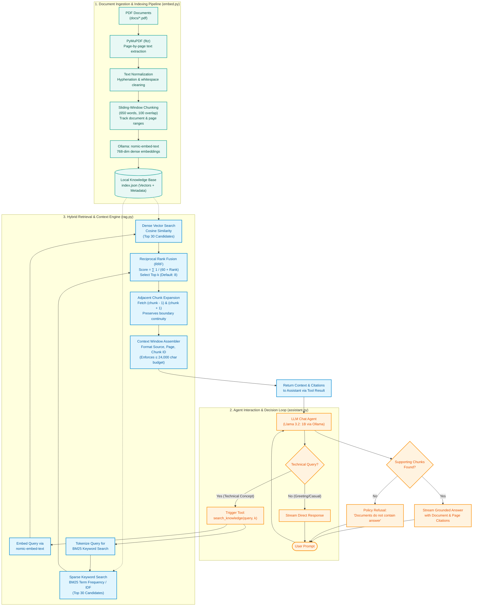
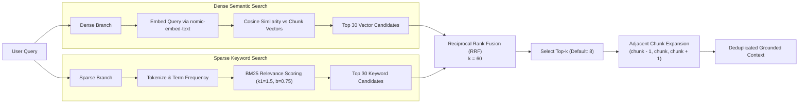
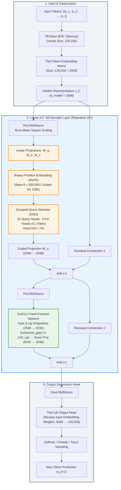
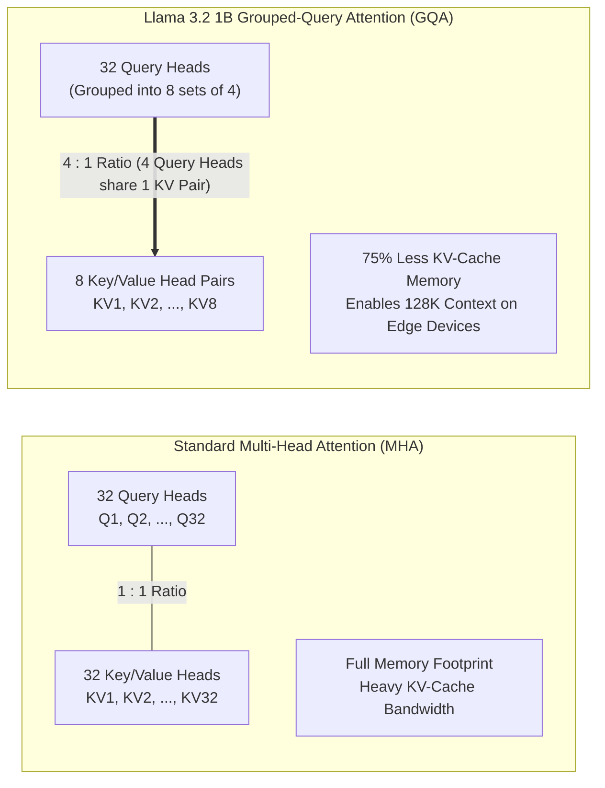

# 🧠 RAG Assistant: Local Hybrid Retrieval-Augmented Generation

An enterprise-grade, privacy-first **Retrieval-Augmented Generation (RAG)** assistant designed to answer complex technical questions over a corpus of PDF research papers. Built entirely locally with **Ollama**, this system combines **Hybrid Search (Dense Vector + BM25 Sparse Keyword)**, **Reciprocal Rank Fusion (RRF)**, **Adjacent Chunk Context Expansion**, and an autonomous **Tool-Calling Agent** powered by **Llama 3.2 (1B)**.

---

## 📑 Table of Contents
1. [System Architecture Overview](#-system-architecture-overview)
2. [End-to-End System Pipeline](#-end-to-end-system-pipeline)
   - [Pipeline 1: Document Ingestion & Vector Indexing (`embed.py`)](#1-document-ingestion--vector-indexing-embedpy)
   - [Pipeline 2: Hybrid Retrieval & Context Assembly (`rag.py`)](#2-hybrid-retrieval--context-assembly-ragpy)
   - [Pipeline 3: Tool-Calling Agent & Guardrails (`assistant.py`)](#3-tool-calling-agent--guardrails-assistantpy)
3. [Llama 3.2 (1B) Architecture Deep-Dive](#-llama-32-1b-architecture-deep-dive)
   - [Key Architectural Specifications](#key-architectural-specifications)
   - [Transformer Decoder Layer Diagram](#transformer-decoder-layer-diagram)
   - [Core Architectural Innovations](#core-architectural-innovations)
     - [1. Grouped-Query Attention (GQA)](#1-grouped-query-attention-gqa)
     - [2. Tied Word Embeddings](#2-tied-word-embeddings)
     - [3. Rotary Position Embeddings (RoPE) & 128K Context](#3-rotary-position-embeddings-rope--128k-context)
     - [4. RMSNorm (Pre-Layer Normalization)](#4-rmsnorm-pre-layer-normalization)
     - [5. SwiGLU Feed-Forward Network](#5-swiglu-feed-forward-network)
     - [6. Knowledge Distillation & Training](#6-knowledge-distillation--training)
4. [🎓 Faculty Presentation & Viva Defense Guide (Q&A Cheatsheet)](#-faculty-presentation--viva-defense-guide-qa-cheatsheet)
5. [Getting Started & Setup](#-getting-started--setup)
6. [Configuration & Hyperparameter Tuning](#-configuration--hyperparameter-tuning)
7. [Repository Structure](#-repository-structure)

---

## 🏛 System Architecture Overview

The system decouples **Offline Document Indexing** from **Online Query Execution & Tool-Calling Generation**. The offline pipeline extracts, chunks, and embeds PDF content into a local vector knowledge base. The online pipeline executes hybrid retrieval when the LLM triggers a tool call, grounds the prompt with verified source citations, and streams an evidence-backed answer.



---

## 🔄 End-to-End System Pipeline

### 1. Document Ingestion & Vector Indexing (`embed.py`)
- **Extraction**: Reads PDFs via `PyMuPDF` (`fitz`), maintaining page-number tracking for precise academic citations.
- **Normalization**: Eliminates broken hyphenated line breaks (`-\n`) and excessive whitespace.
- **Sliding-Window Chunking**:
  - `CHUNK_SIZE = 650 words`
  - `CHUNK_OVERLAP = 100 words`
  - Preserves token continuity across paragraph boundaries.
- **Dense Embedding**: Calls Ollama's `nomic-embed-text` to generate high-density 768-dimensional embeddings for each chunk.
- **Persistent Storage**: Serializes chunks, metadata (source file, start page, end page, chunk ID), and vector embeddings into `index.json`.

---

### 2. Hybrid Retrieval & Context Assembly (`rag.py`)

A pure vector search can miss exact domain acronyms, model names, and mathematical symbols, while pure keyword search misses synonyms and semantic intent. This system fuses both:

$$\text{Hybrid Retrieval} = \text{Dense Vector Search (Cosine)} + \text{Sparse Lexical Search (BM25)} \xrightarrow{\text{RRF}} \text{Ranked Chunks}$$



#### A. Dense Vector Retrieval
Calculates the cosine similarity between the query vector $\vec{q}$ and document chunk vector $\vec{d}$:
$$\text{Cosine Similarity}(\vec{q}, \vec{d}) = \frac{\vec{q} \cdot \vec{d}}{\|\vec{q}\| \|\vec{d}\|}$$
Returns the top 30 semantically nearest candidates.

#### B. Sparse BM25 Keyword Retrieval
Implements standard BM25 probabilistic relevance scoring:
$$\text{Score}_{\text{BM25}}(D, Q) = \sum_{t \in Q} \text{IDF}(t) \cdot \frac{f(t, D) \cdot (k_1 + 1)}{f(t, D) + k_1 \cdot \left(1 - b + b \cdot \frac{|D|}{\text{avgdl}}\right)}$$
Where $k_1 = 1.5$, $b = 0.75$, and $|D|/\text{avgdl}$ penalizes overly long documents. Returns the top 30 keyword candidates.

#### C. Reciprocal Rank Fusion (RRF)
Vector cosine scores (bounded in $[-1, 1]$) and BM25 scores (unbounded $[0, \infty)$) cannot be simply summed without normalization bias. RRF solves this by combining ordinal positions (ranks):
$$\text{RRF Score}(d) = \sum_{m \in \{\text{Vector}, \text{BM25}\}} \frac{1}{k + r_m(d)}$$
Where $k = 60$ is a smoothing constant, and $r_m(d)$ is the 1-based rank of document $d$ in system $m$.

#### D. Adjacent Chunk Context Expansion
Chunking can arbitrarily bisect critical proofs, equations, or explanations. After selecting the top $k$ chunks via RRF, `add_neighboring_chunks()` pulls chunk $i-1$ and chunk $i+1$ from the same document. This provides uninterrupted surrounding context to the model while maintaining deduplication.

---

### 3. Tool-Calling Agent & Guardrails (`assistant.py`)
- **Agent Loop**: Communicates with Ollama using native function calling (`tools=[search_knowledge]`).
- **Autonomous Intent Classification**:
  - Conversational pleasantries ("hello", "thank you") are answered directly without overhead.
  - Technical questions trigger an automatic tool call to query the PDF index.
- **Strict Grounding & Hallucination Prevention**:
  - System prompts enforce that answers must be derived solely from retrieved passages.
  - Explicit document and page citations are required for every factual assertion.
  - **Refusal-by-Policy**: If no supporting chunks are retrieved, the agent explicitly replies that the knowledge base does not contain the answer, refusing to invent hallucinated information.

---

## 🦙 Llama 3.2 (1B) Architecture Deep-Dive

Meta's **Llama 3.2 (1B)** is an autoregressive, decoder-only Transformer specifically designed for edge devices, mobile compute, and high-throughput tool-calling agents.

### Key Architectural Specifications

| Parameter / Feature | Value | Engineering Significance |
|---|---|---|
| **Model Class** | Autoregressive Decoder-Only Transformer | Next-token prediction with causal attention masking |
| **Total Parameter Count** | **~1.23 Billion (1.23B)** | Ultra-lightweight footprint (< 1.5 GB in 4-bit quantization) |
| **Transformer Layers ($N_{\text{layers}}$)** | **16 Layers** | Depth optimized for low-latency inference on CPUs and laptops |
| **Hidden Dimension ($d_{\text{model}}$)** | **2048** | Width of internal token representations across blocks |
| **Intermediate FFN Dimension** | **8192 ($4 \times d_{\text{model}}$)** | Expanded non-linear feature space in SwiGLU MLP layers |
| **Attention Mechanism** | **Grouped-Query Attention (GQA)** | 4:1 query-to-KV head ratio, drastically reducing KV cache size |
| **Query Heads ($H_Q$)** | **32 Heads** | Multi-head query projections for rich expressiveness |
| **Key/Value Heads ($H_{KV}$)** | **8 Heads** | Shared key/value representations across groups of 4 query heads |
| **Head Dimension ($d_{\text{head}}$)** | **64** ($2048 / 32$) | Inner attention subspace dimensionality |
| **Max Context Window** | **131,072 tokens (128K)** | Long-context comprehension via scaled RoPE |
| **Vocabulary Size** | **128,256 tokens** | TikToken BPE tokenizer (same vocabulary as Llama 3 70B) |
| **Tied Word Embeddings** | **`true` (Enabled)** | Input embeddings and output `lm_head` share the same matrix |
| **Positional Embeddings** | **Rotary Position Embeddings (RoPE)** | Relative rotation in 2D subspaces with base $\theta = 500,000$ |
| **Normalization** | **RMSNorm (Pre-Norm)** | Root Mean Square Normalization before each sublayer |
| **Activation Function** | **SwiGLU** | Swish-Gated Linear Unit for optimal gradient dynamics |
| **Pre-training & Distillation** | **9 Trillion tokens + Distillation** | Trained with logit distillation from Llama 3.1 8B and 70B |

---

### Transformer Decoder Layer Diagram

Below is the detailed inner architecture of a single Llama 3.2 (1B) Transformer block (repeated 16 times):



---

### Core Architectural Innovations

#### 1. Grouped-Query Attention (GQA)
In traditional **Multi-Head Attention (MHA)**, every single Query head has its own Key head and Value head (32 Q, 32 K, 32 V). As context length scales to 128K tokens, storing Key-Value states in memory (the KV-cache) becomes a massive memory and bandwidth bottleneck during autoregressive token generation.

**Grouped-Query Attention (GQA)** groups query heads into clusters that share a single Key-Value head pair:
- **Llama 3.2 1B Configuration**: 32 Query Heads, 8 Key/Value Heads.
- **Ratio**: $32 / 8 = 4$ Query heads per 1 KV head pair.
- **Advantage**: **75% reduction in KV-cache memory footprint and memory bandwidth** compared to MHA, enabling high generation speeds and long-context reasoning on edge hardware with minimal loss in model quality.



---

#### 2. Tied Word Embeddings
In large models like Llama 3.1 8B or 70B, the input token embedding matrix and the final output classification layer (`lm_head`) have separate, independent weight matrices.

However, in a **1.23B parameter model** with a massive vocabulary of **128,256 tokens** and hidden dimension $d_{\text{model}} = 2048$:
$$\text{Matrix Size} = 128,256 \times 2048 \approx 262,668,288 \text{ parameters (~262.7M)}$$

If input and output weights were untied:
$$2 \times 262.7\text{M} \approx 525.4\text{M parameters}$$
This would consume **over 42% of the model's entire parameter budget** on vocabulary embeddings alone!

**The Engineering Solution**: Llama 3.2 (1B) configures `tie_word_embeddings = true`. The output linear layer reuses the exact transpose of the input embedding matrix:
$$\text{Logits} = x \cdot W_{\text{embed}}^T$$
This saves **~262.7 million parameters**, freeing up critical capacity for deeper transformer feed-forward layers.

---

#### 3. Rotary Position Embeddings (RoPE) & 128K Context
Unlike absolute positional embeddings that are simply added to token vectors, **Rotary Position Embedding (RoPE)** rotates the query and key vectors in 2D coordinate slices based on token index $m$:

$$R_{\Theta, m}^d = \text{diag}\left(R_{\theta_1, m}, R_{\theta_2, m}, \dots, R_{\theta_{d/2}, m}\right)$$
Where:
$$R_{\theta_i, m} = \begin{pmatrix} \cos(m\theta_i) & -\sin(m\theta_i) \\ \sin(m\theta_i) & \cos(m\theta_i) \end{pmatrix}, \quad \theta_i = \theta^{-2(i-1)/d}$$

- **Base Frequency ($\theta$)**: Scaled to **500,000** (up from standard 10,000).
- **Relative Position Property**: The inner product $\langle R_m q, R_n k \rangle$ depends only on the relative token distance $(m - n)$, allowing graceful context length generalization up to **131,072 tokens (128K)**.

---

#### 4. RMSNorm (Pre-Layer Normalization)
Standard Layer Normalization centers features by subtracting their mean and normalizes by their standard deviation:
$$\text{LayerNorm}(x) = \frac{x - \mu}{\sqrt{\sigma^2 + \epsilon}} \odot \gamma + \beta$$

**RMSNorm (Root Mean Square Normalization)** hypothesizes that shift-invariance (mean subtraction) is redundant and computationally wasteful. It normalizes strictly by the root mean square:
$$\text{RMSNorm}(x) = \frac{x}{\text{RMS}(x)} \odot \gamma, \quad \text{where } \text{RMS}(x) = \sqrt{\frac{1}{d} \sum_{i=1}^d x_i^2 + \epsilon}$$
- **Speed**: Saves ~7%–10% compute time per layer by skipping mean calculation.
- **Pre-Norm Formulation**: Applied before attention and FFN blocks (rather than after), ensuring smooth gradient propagation across deep networks.

---

#### 5. SwiGLU Feed-Forward Network
Traditional transformers use standard ReLU or GELU feed-forward networks:
$$\text{FFN}_{\text{standard}}(x) = \text{Activation}(x W_1 + b_1) W_2 + b_2$$

Llama 3.2 uses **SwiGLU (Swish Gated Linear Unit)** with an intermediate dimension of $8192$:
$$\text{SwiGLU}(x) = \left(\text{Swish}(x W_{\text{gate}}) \otimes (x W_{\text{up}})\right) W_{\text{down}}$$
Where $\text{Swish}(z) = z \cdot \sigma(z)$. The gating mechanism acts as a learned attention filter over features, dynamically regulating information flow and yielding higher training efficiency.

---

#### 6. Knowledge Distillation & Training
Llama 3.2 1B was not trained in isolation. Meta utilized **Teacher-Student Knowledge Distillation**:
- **Teacher Models**: Llama 3.1 8B and Llama 3.1 70B.
- **Mechanism**: The student (1B) was trained to minimize the cross-entropy loss against both the ground-truth token targets and the probability distribution (logits) of the teacher models across **9 Trillion tokens**.
- **Outcome**: Transfers sophisticated reasoning, mathematical intuition, and instruction-following / tool-calling capabilities into a 1B parameter edge footprint.

---

## 🚀 Getting Started & Setup

### 1. Prerequisites
- **Python 3.10+**
- **Ollama**: Download and install from [ollama.com](https://ollama.com/).

### 2. Pull Required Models
Pull the embedding model and the **Llama 3.2 (1B)** chat model:
```bash
ollama pull nomic-embed-text
ollama pull llama3.2:1b
```

*(Note: Other models like `lfm3-omni:2b` or `qwen2.5:1.5b` can also be used by changing `MODEL` in `assistant.py`)*.

### 3. Setup Virtual Environment
```bash
# Clone or navigate to the repository
cd e:/Projects/RAG-Assistant

# Create virtual environment
python -m venv venv

# Activate virtual environment
# Windows (PowerShell):
venv\Scripts\Activate.ps1
# Windows (cmd):
venv\Scripts\activate.bat
# Linux / macOS:
source venv/bin/activate

# Install dependencies
pip install -r requirements.txt
```

### 4. Ingest Documents
Place your research papers or documentation PDFs into the `docs/` folder:
```bash
# Example files in docs/:
# - attention-is-all-you-need.pdf
# - gqa.pdf
# - deepseek-v3.pdf
```
Build the hybrid embedding index:
```bash
python embed.py
```
This generates `index.json` containing chunk text, page spans, and 768-dimensional embeddings.

### 5. Launch the Assistant
```bash
python assistant.py
```
Type your technical questions at the prompt (e.g., *"Explain how Grouped-Query Attention works and cite the paper"*). Type `exit` or `quit` to end the session.

---

## ⚙️ Configuration & Hyperparameter Tuning

All parameters can be tuned directly at the top of each module:

| File | Parameter | Default | Description |
|---|---|---|---|
| `assistant.py` | `MODEL` | `"llama3.2:1b"` | Chat LLM model used for tool calling & generation |
| `assistant.py` | `DEFAULT_K` | `8` | Number of core chunks requested from the retrieval engine |
| `assistant.py` | `MAX_TOOL_ROUNDS` | `5` | Maximum autonomous tool iterations per user query |
| `rag.py` | `EMBED_MODEL` | `"nomic-embed-text"` | Ollama model used to embed the user query |
| `rag.py` | `VECTOR_CANDIDATES` | `30` | Top candidates returned by cosine vector similarity |
| `rag.py` | `KEYWORD_CANDIDATES` | `30` | Top candidates returned by BM25 keyword scoring |
| `rag.py` | `FINAL_CHUNKS` | `8` | Top RRF candidates to select before adjacent expansion |
| `rag.py` | `RRF_K` | `60` | Smoothing constant in the Reciprocal Rank Fusion formula |
| `rag.py` | `CONTEXT_CHAR_LIMIT` | `24000` | Safety context budget passed to the LLM |
| `embed.py` | `CHUNK_SIZE` | `650` | Word count per text chunk |
| `embed.py` | `CHUNK_OVERLAP` | `100` | Overlapping word count between consecutive chunks |

---

## 📁 Repository Structure

```
RAG-Assistant/
├── docs/                      # Corpus of PDF technical papers
│   ├── attention-is-all-you-need.pdf
│   ├── deepseek-v2.pdf
│   ├── deepseek-v3.pdf
│   ├── gqa.pdf
│   ├── mqa.pdf
│   └── qwen2.5.pdf
├── embed.py                   # Ingestion, sliding-window chunker & embedding generator
├── rag.py                     # Hybrid retriever (Cosine + BM25 + RRF + Neighbor Expansion)
├── assistant.py               # Interactive CLI agent with tool-calling & citation grounding
├── requirements.txt           # Python dependencies (ollama, pymupdf)
├── index.json                 # Generated vector index & chunk metadata (gitignored)
└── README.md                  # Comprehensive architectural documentation & faculty guide
```
